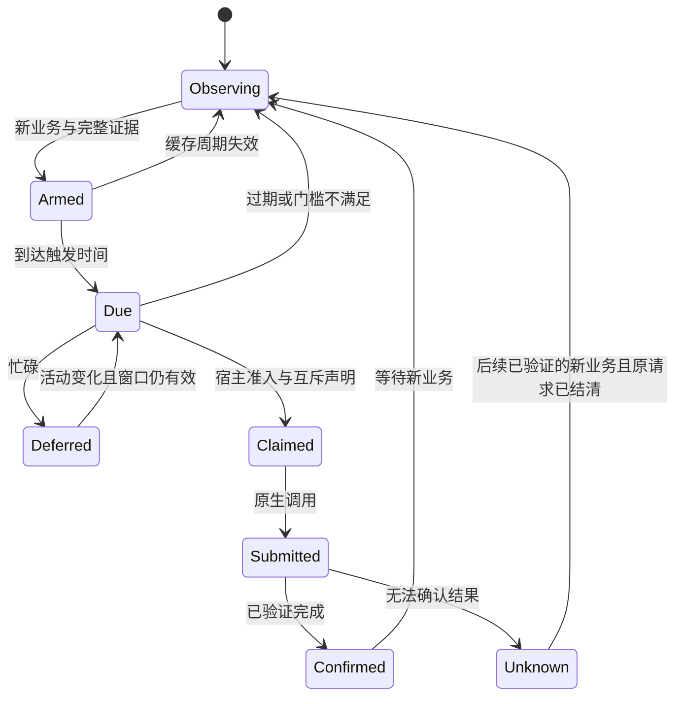

# Auto Compact 设计方案

状态：设计草案，尚未实现。本文中的配置、Omha 命令、事件与文件布局均为拟议契约。
调研日期：2026-10-18。实施时以目标 Claude Code 版本实际提供的类型和协议为准。

## 1. 目标与范围

在长会话的 prompt cache 仍可复用时自动生成压缩摘要，降低长时间离开后重新处理完整
历史的成本与延迟。默认在一小时缓存周期的第 **57 分钟**评估执行，且上下文占比必须
**大于或等于 20%**。

57 分钟从最近一次有效缓存刷新计算，不从终端启动或上一次 compact 完成时间计算。
持续命中缓存的正常工作会刷新到期时间。缓存过期不会删除聊天记录；这里优化的是
重新处理历史的开销。

首版只覆盖已验证的 Claude Code 交互主会话。Codex、Kimi、子代理、Arena/Fork 分支和
单次 headless 请求不自动继承这一小时假设。首版不增加模型生成的摘要实现、不启动
额外的预热请求，也不改写原始会话文件。

## 2. 已验证能力与实施前提

| 能力                 | 调研结论                                                                                                 | 设计含义                                                       |
| -------------------- | -------------------------------------------------------------------------------------------------------- | -------------------------------------------------------------- |
| 原生压缩的成本       | Claude Code 的摘要请求沿用原上下文前缀，缓存仍热时可以复用；过期后需要重新处理完整历史 [S1]              | 压缩必须发生在有效窗口内，过期后跳过自动维护                   |
| 原生 idle compaction | 官方描述约在最后请求后 54 分钟触发；默认上下文门槛 200,000 tokens，可配置但最低 100,000 [S2]             | 原生功能不能直接表达 57 分钟和所有窗口下的 20%；必须协调执行者 |
| Mods                 | 终端正式支持版本为 2.1.287+，是同一个 Claude Code plugin 内的函数 hooks [S3]                             | 优先采用进程内 Mod，无需外部守护进程或模拟键盘                 |
| 定时                 | `$.clock.after/every` 支持后台回调；热重载会取消旧模块的定时器 [S4]                                      | 定时器绑定会话与模块生命周期，重载后从持久记录恢复             |
| 上下文读取           | `$.session.usage()` 提供 `context.tokens/window/percent`；普通读取不调用计数 API [S5]                    | 使用宿主统计，禁止按对话文件大小估算                           |
| 原生执行             | `$.session.compact()` 与 `/compact` 使用同一压缩流程，返回压缩结果或 `skip`；执行中有 turn 时会拒绝 [S6] | API 成功、跳过、拒绝和不确定结果分别处理                       |
| 缓存观察             | 状态栏 JSON 提供 `prompt_cache.ttl/warm/expires_at/caching_observed` [S7]                                | 优先读取结构化缓存证据，时间单位转换后再计算                   |
| 压缩观察             | Mods 有 `session.compact`；传统 hooks 有 `PreCompact/PostCompact` [S6][S8]                               | 手动、原生自动和 Omha 压缩共同推进去重边界                     |

版本号只是第一道检查。必须对目标版本验证事件、类型、忙碌拒绝、成功确认和原生 idle
协调行为。上游 GitHub 类型快照可能落后于实际版本，不能直接视为当前运行时的保证。
完整执行模式以 2.1.290+ 为目标基线，因为单独关闭 native idle compaction 的设置也有
该版本要求；只有 Mods 而不能完成执行者协调的版本仍保持观察模式。

特别注意：已查到的 `$.session.usage()` 契约没有承诺包含 `prompt_cache`。
不能编造 `$.session.usage().prompt_cache` 字段。缓存证据的实际连接方式属于首个验证任务。

## 3. 推荐架构


Mod 负责观察当前会话、维护本地定时器、调用当前会话的原生压缩 API。CLI 负责配置
验证、作用域、预算、并发声明、持久化和恢复。提示词不参与准入判断。

传统 command hooks 可以观察生命周期与压缩完成，但只有事件发生时才运行。一个
`Stop` hook 不能独自保证空闲到第 57 分钟时执行；等待 57 分钟的 hook 也不应阻塞
Claude。首版因此选 Mod，传统 hooks 只用于观察补充，不实现第二套调度器。

## 4. 配置契约

扩展现有 version 1 provider 配置的宿主维护字段，继续采用现有配置发现优先级：
`--config`、项目 `.omha/providers.json`、`OMHA_HOME/providers.json`。
不增加另一份同名策略文件或兼容别名。

以下为添加到现有配置中的拟议字段，不是当前可运行的完整 provider 配置：

```json
{
  "maintenance": {
    "autoCompact": {
      "enabled": true,
      "afterMinutes": 57,
      "minContextPercent": 20,
      "minIntervalMinutes": 10,
      "minRemainingSeconds": 30,
      "maxCompactionsPerSession": 8
    }
  }
}
```

| 字段                       | 默认值  | 语义与验证                                                                |
| -------------------------- | ------- | ------------------------------------------------------------------------- |
| `enabled`                  | `false` | 项目或用户显式开启；安装提示词插件不会自行开启维护                        |
| `afterMinutes`             | `57`    | 当前一小时缓存周期开始后多久评估；整数 1–59，且必须为执行留下有效窗口     |
| `minContextPercent`        | `20`    | 范围 0–100；小于阈值跳过，等于阈值允许继续评估                            |
| `minIntervalMinutes`       | `10`    | 整数 0–1440；任意两次已确认压缩之间的自动维护冷却期，不替代对话增量检查   |
| `minRemainingSeconds`      | `30`    | 整数 1–3599；发起时要求距离缓存预计到期还剩多少秒，并受下面的联合条件约束 |
| `maxCompactionsPerSession` | `8`     | 每个真实主会话允许的 Omha 维护请求上限；范围 1–32；结果未知也消耗一次     |

必须满足 `afterMinutes * 60 + minRemainingSeconds < 3600`。首版遇到五分钟 TTL、未知
TTL 或无缓存证据时跳过，而不是把 57 分钟静默改成别的时长。后续支持其他 TTL 时
再扩展明确的分 TTL 策略。

未知字段、非有限数字和无效范围直接失败。策略由 CLI 验证并冻结哈希，planner 或
skill 不能提供或覆盖它。配置修改会撤销尚未使用的声明并重新评估；不会重放不确定请求。

## 5. 观察来源与数据新鲜度

| 数据                             | 首选来源                                                      | 缺失时行为                             |
| -------------------------------- | ------------------------------------------------------------- | -------------------------------------- |
| session、工作目录、模型          | Mods 原生 session API                                         | 无法绑定则只观察                       |
| 上下文占比                       | 普通 `$.session.usage()`                                      | 缺失为 unknown，禁止沿用压缩前的旧占比 |
| 请求起点、请求完成与主线程身份   | `turn.step` 与 `turn.complete` 的结构化事件                   | 不用任意工具输出或屏幕活动刷新缓存时钟 |
| TTL、预计到期时间、缓存使用记录  | 目标版本的原生结构化状态；已公开的状态栏 JSON 可作为补充 [S7] | 无证据则跳过                           |
| 手动与自动压缩边界               | `session.compact` 结果、`PostCompact` 或原生边界 ID           | 无法确认则 unknown，不自动重试         |
| turn、工具、权限等待与子代理状态 | 生命周期事件和原生 agent 状态                                 | 活动状态不明确则视为忙碌               |

若目标 Mods API 不能直接提供缓存字段，首版允许显式启用一个状态栏 JSON 桥接器：
复用同一次原生状态快照，将最小元数据提交给 CLI，并原样转发用户现有状态栏的输入
与输出。必须验证取消、刷新、退出码和输出保持行为，不能覆盖用户已有状态栏。
没有可兼容的桥接方式时，状态显示 `cache_observation_unavailable`，不执行自动压缩。

桥接器只提供观察数据，不能发起压缩或成为第二个调度器。无需传输原始提示词、工具
结果、摘要或完整 transcript。结构化 transcript 解析仅作为后续明确验证的兼容选项，
不在首版默认路径中加入。

对上下文占比统一使用原生输入侧统计，包含 uncached input、cache read 与 cache
creation，不使用累计总 token，也不把输出 token 重复加入。200K 窗口的 20% 为
40K；1M 窗口的 20% 为 200K。全量 `/context` 计数可能调用计数 API，不用于周期观察。

界面百分比可能取整。准入优先比较原始计数：
`contextTokens * 100 >= minContextPercent * windowTokens`，不先四舍五入。
只有显示百分比、没有原始计数且无法确认精度时，阈值边界按 unknown 处理，不能将
实际 19.99% 因显示为 20% 而放行。

`warm` 和 `expires_at` 是宿主根据 usage 推导的预计状态，不证明后续请求一定命中缓存。
实际命中仍以该请求的 usage 为准，不能将预计节省记录为实际节省。

## 6. 触发公式与准入条件

对于已观察到的一小时 TTL：

```text
dueAt = expiresAt - (3600 - afterMinutes * 60) * 1000
latestStartAt = expiresAt - minRemainingSeconds * 1000
```

状态栏时间戳是 epoch seconds，内部统一转换为 epoch milliseconds。例如缓存于
14:00 刷新，预计 15:00 到期，则默认 14:57 评估，最晚 14:59:30 发起。
14:40 的新请求刷新了缓存后，旧定时器失效，重新使用新的到期时间。

实际执行必须同时满足：

1. 策略有效、已开启，CLI 与 Mod 能力检查通过，当前 session 绑定没有改变。
2. 观察到主会话缓存，TTL 为一小时，且没有模型、计费路径或前缀变化使证据失效。
3. 当前处于 `dueAt <= now < latestStartAt` 的执行窗口内。
4. 最近的有效上下文测量达到 `minContextPercent`。
5. 主会话没有活动 turn、工具调用、权限等待、待处理输入或队列中的业务请求；首版也
   等待活动子代理结束，避免主会话在依赖后台结果时被改动。
6. 最近一次压缩之后确有新的有效业务对话，且已超过冷却期。
7. 该业务版本尚未有已提交或结果不确定的 Omha 压缩请求。
8. 无并行 compact，宿主成功写入唯一执行声明，并完成预算与次数准入。
9. 没有覆盖相同业务版本、仍可复用的原生预计算摘要，避免为同一历史重复生成摘要。

到点忙碌时只记录等待。收到完成、活动状态变化或有限的重新检查时再评估全部条件。
窗口关闭后记录 `expired`，不在下一次用户输入时补发冷缓存压缩。

## 7. 防止连续 compact 的核心不变量

仅靠冷却时间不够。采用以下状态：

```text
workRevision                  已经由主会话处理的有效业务版本
lastCompactedWorkRevision      任意来源最近一次成功压缩覆盖的业务版本
lastAttemptedWorkRevision      Omha 最近一次提交或无法确认提交的业务版本
compactBoundary               原生压缩边界或可验证的替代标识
cacheEpoch                    当前模型、缓存状态和到期时间对应的观察版本
```

**只有 `workRevision > lastCompactedWorkRevision`，并且当前业务版本没有未解决的
提交记录，才允许自动压缩。**

有效业务版本来自已确认处理的正常主会话请求。手动 `/compact`、Omha 压缩、压缩内部
摘要请求、状态查询、定时器、心跳、模块重载、缓存统计刷新和单纯收到尚未处理的输入
都不增加该版本。原生消息/请求标识用于去重；无法判定来源时不据此重新启用压缩。

因此：

- 用户刚手动 compact，Omha 的旧定时器即失效，随后不会再自动 compact。
- 原生自动 compact 成功后，Omha 同样保持未重新启用状态。
- Omha compact 后即使摘要仍超过 20%，没有新的业务对话也不会再次触发。
- 用户新增业务并完成主会话处理后，重新读取上下文与缓存状态，满足条件才重新计时。
- 失败、提交不确定、超时均不在同一业务版本自动重试。

这一约束管控 Omha 的自动行为。用户明确要求的手动压缩保留控制权，原生上下文超限
恢复也保留优先级；不能为维护去重而禁止必要的上下文恢复。

## 8. Mod 事件与执行方式

| 事件或 API            | 拟议用途                                                                |
| --------------------- | ----------------------------------------------------------------------- |
| `session.start`       | 加载宿主策略、绑定会话、恢复状态；不得因为每次重载都把会话当成新会话    |
| `turn.start`          | 标记忙碌，撤销尚未提交的自动维护声明                                    |
| `turn.step`           | 观察主请求身份和 usage；排除子代理、压缩内部请求，刷新缓存证据          |
| `turn.complete`       | 更新业务版本、空闲状态与上下文测量，重新评估                            |
| `session.compact`     | 在执行前标记任何来源的压缩；执行后区分已应用、仅预计算、skip 与 unknown |
| `classic.PostCompact` | 作为目标版本验证后的完成观察补充，与原生结果合并去重                    |
| `session.end`         | 取消计时器和未提交声明；`/clear`、resume、fork 切换均重新绑定           |
| `$.clock.after`       | 为当前 cacheEpoch 预约一次到点评估                                      |
| `$.session.compact()` | 在宿主准入后调用原会话的 `/compact` 实现                                |

使用 API 的成功结果或原生完成边界确认压缩完成，不能根据 UI 文本、消息已送达或
子进程退出码确认。`skip` 是跳过，不能算成功。调用拒绝为忙碌时，只有经验证能够
证明尚未发送摘要请求的结果才可释放未使用声明；其他异常一律按不确定处理。

仅预计算成功不推进 `lastCompactedWorkRevision`，也不宣称会话已被压缩。单独记录其
覆盖的业务版本与原生可复用状态；该摘要仍有效时不再次发起 Omha 摘要请求。

执行前再次检查 cacheEpoch、业务版本、上下文、会话身份与空闲状态。检查与调用之间
仍可能收到用户输入，因此还必须验证原生 API 的并发互斥和忙碌拒绝语义。
禁止用 `$.prompt.submit({text: "/compact"})`、Agent 消息、模拟按键或新 headless
进程替代已验证的原生 API。

## 9. 与原生自动压缩协调

首版采用**每个会话只有一个缓存到期前压缩执行者**：

- `native`：Claude 自己负责 idle compaction；Omha 只观察，不承诺使用 57 分钟与 20%。
- `omha`：Omha 负责本设计的策略；原生 idle compaction 必须已被明确停用。

推荐在宿主启动已配置的 Claude 会话时，通过单次会话 `--settings` 覆盖绑定
`idleCompaction:false`。不改写全局设置，不改变模型、权限或计费路径。
已经运行的会话只有在 `$.settings.read()` 等来源能确认有效设置后才进入执行模式；
否则显示 `native_idle_conflict`，保持观察，下一次按配置启动时生效。

**不关闭 `autoCompactEnabled`**，保留原生上下文阈值压缩与超限恢复。文档提到旧版
可通过关闭全部 auto compact 停止 idle compaction，这个降级方式不采用。

Mods 的 `precompute` 是摘要预计算，不一定表示已经应用压缩，也不能未经验证就等同
于原生 idle 触发。首版不靠猜测 trigger 的含义接管原生行为。

原生阈值压缩、手动压缩、其他插件压缩均进入共同边界记录。目标版本若不能保证原生
与 Mod 压缩互斥，首版拒绝自动执行。手动压缩已开始时，Omha 撤销自己的未提交声明。

停用 Omha 时同时撤销维护所有权，供下一次会话按用户正常设置启动。已经进入 Omha
模式的会话停用后显示当前 idle 维护已停止；不宣称可以热恢复仅在启动时绑定的设置。

## 10. 状态机、持久化与恢复



状态复用 `lib/terminal.mjs` 的生命周期边界及 `lib/storage.mjs` 的锁、原子写入与追加
事件。为无需 cmux 的 Mod 会话增加维护记录，不创建第二套 provider 执行器。

建议记录的最小字段：schema version、project/session/binding ID、策略哈希、owner token
及本地宿主指纹、cacheEpoch 与证据来源、dueAt/expiresAt、上下文百分比与采样版本、
conversationEpoch、业务版本、最近压缩边界、operation ID、准入预算、请求状态和终态。

采用 `(projectId, sessionId, conversationEpoch, workRevision)` 作为自动请求的唯一键，
提交前先持久化声明。`conversationEpoch` 表示原生对话边界，resume 与模块重载不会
创建新边界；明确的 clear 或新对话才创建新边界。进程重启后的新 binding 不能绕过
旧声明，同一 session 的维护次数也不会因此清零。
租约记录的是受管进程，存活的所有者不会因为锁老化被替换。
Mod 的本地变量和 `$.state` 可缓存状态，但不作为崩溃恢复的事实来源。

崩溃可能发生在原生 API 已执行而宿主尚未记下结果之间，无法承诺跨进程 exactly-once。
本设计保证同一业务版本不盲目重发，优先从原生压缩边界结清；没有完成证据则保持
unknown，不释放预算、不启动第二次压缩。新业务到来也不能绕过尚未结清的 in-flight。

热重载取消旧定时器，基于同一 session 和持久记录重建。resume、fork、`/clear`、模型
或前缀变化均使旧声明失效；不继承另一会话的定时器。机器休眠、时钟显著变化后先
重读有效证据，已经过期的周期直接跳过，不补偿执行。

## 11. 预算、故障与安全边界

复用现有 runtime 预算预留和结算机制，将 compact 记录为额外维护请求，执行仍留在
原生会话。宿主必须能将会话映射到经验证的维护预算；无法准入就跳过。
一次已提交或结果未知的 compact 消耗一次维护次数。

实际 usage 可得时结算并保留请求/实际模型来源；不可得时保留预留并记录 unknown。
token/cost 预留不是实际账单硬上限，订阅额度的消耗也不能伪造为已知美元成本。
不得为了取得 usage 而把终端会话切换到 API 或启动另一份 provider。

| 情况                                     | 行为                                             |
| ---------------------------------------- | ------------------------------------------------ |
| 上下文小于阈值、未知或刚压缩后尚无新测量 | 跳过，不调用 token-count API                     |
| 五分钟 TTL、缓存字段缺失或缓存关闭       | 跳过，不宣称当前缓存仍热                         |
| 新请求刷新缓存                           | 废弃旧 timer/claim，使用新周期                   |
| 到点仍忙碌、权限等待或后台依赖未结束     | 有界等待，窗口结束后放弃                         |
| 手动或原生压缩抢先开始                   | 撤销未提交 Omha 声明，等待共同完成边界           |
| 预算不足、次数用尽                       | 记录原因并停止准入                               |
| 所有权、session、模型、策略哈希变化      | 拒绝旧声明，重新绑定                             |
| CLI 不可用、Mod 不支持、hooks 被关闭     | 保留普通会话和提示词 skills；说明自动维护未运行  |
| 原生请求失败、网络错误、通知失败         | 记录 failure/unknown，不切换 provider 或自动重试 |
| 摘要完成后测量未知                       | 清除旧测量，等待正常业务请求带回新数据           |

日志只写最小元数据、哈希与状态，不复制完整对话或摘要；证据落入现有状态目录，
沿用路径保护、所有权、大小限制和脱敏规则。自动维护不修改权限审批与原生安全 hooks。

## 12. 可观察性与用户入口

拟扩展 `omha status` 的会话维护状态，并提供 `omha compact status` 的只读详情。
查询不启动 Mod、不读取屏幕、不触发维护。

展示：策略来源与哈希、执行者 native/omha、运行能力、57 分钟配置、20% 门槛、最近
上下文测量、预计缓存到期时间、下次评估时间、是否有新业务、等待/跳过原因、次数、
预算预留与最近终态。缺失值显示 unknown。

追加事件建议为 `compact.observed`、`compact.armed`、`compact.due`、
`compact.deferred`、`compact.claimed`、`compact.submitted`、`compact.confirmed`、
`compact.skipped`、`compact.failed`、`compact.unknown`。重复观察与相同 skip 原因合并，
状态变化及准入/执行/结果证据完整保留。达到预设存储上限时停止新的维护准入，
不截断已有审计证据。

## 13. 文件与插件集成

| 位置                                     | 拟议职责                                                 |
| ---------------------------------------- | -------------------------------------------------------- |
| `lib/profiles.mjs`、providers schema     | 新增维护策略验证，继续拒绝未知字段                       |
| `lib/terminal.mjs`                       | 会话维护注册、声明、状态、压缩观察与恢复                 |
| `lib/storage.mjs`                        | 复用现有原子记录、锁与追加日志，不再实现另一套           |
| `lib/runner.mjs`                         | 复用预算预留/结算；不增加新的 provider 启动路径          |
| `lib/orchestrator.mjs`                   | 汇总维护状态；与任务生命周期关联但不把压缩当作任务验收   |
| `bin/omha.mjs`                           | 宿主策略、声明、观察接口及只读状态入口                   |
| `hooks/hooks.json`、`hooks/register.mjs` | 同一个 `omha` 插件内的 Mod 注册、观察、timer 与原生调用  |
| `package.json`、pack check               | 将 `hooks` 纳入已安装包并验证发现；不新增第二个 manifest |
| `docs/plugin.md`、`skills/README.md`     | 说明显式启用、版本门槛、CLI 依赖、降级及安装后行为       |

Mod 不导入 Node 内置模块或外部 npm 包。进程和状态访问通过 Mods API 与已有 CLI，
模块注册不得隐式安装或升级 CLI。当前七个 skills 保留提示词职责，任何 `SKILL.md`
都不通过自动 hooks 自行授予执行权限。

旧 Claude 的插件加载兼容性必须做真实离线验证。若新增 `modules` 会让旧版连提示词
skills 都无法加载，不能直接把它加入默认分发；在维持同一插件身份的前提下先解决
兼容加载方案。不能仅写一个运行时版本判断，就假设旧版解析器能忽略新格式。

## 14. 实施顺序与验收

### 阶段一：运行时契约验证

使用支持 Mods 的目标 Claude 版本，生成该版本类型并离线验证最小插件。确认上下文
读取、timer、压缩结果/skip、主请求身份、缓存字段取得方式、native idle 覆盖生效、
热重载和并发拒绝语义。明确哪些测试只用 fake，哪些必须做本地 CLI 协议探测。
此阶段不调用真实模型、不自动更新用户 CLI。

### 阶段二：策略与离线宿主实现

完成策略 schema、触发判断、业务版本、状态重放、互斥声明、预算与只读状态。
使用虚拟时钟及 provider/Mod fixtures，不真实等待 57 分钟。

### 阶段三：Mod 与原生压缩集成

接通已验证接口和共同压缩边界，加入 native/omha 单一执行者规则，完成支持版本及
旧版提示词加载的包装验证。真实收费压缩实验作为单独、明确的验证步骤，默认检查不调用。

### 阶段四：交付

更新插件指南、skills 说明、CLI 帮助与 changelog。运行适用离线检查、两个 manifest
的 strict validation、完整 pack check，并按仓库约定提交推送；未运行的真实模型或
平台验证明确标记为未验证，不以 mock 通过替代。

关键验收场景：

| 场景                                    | 预期                         |
| --------------------------------------- | ---------------------------- |
| 56:59，上下文 80%                       | 不执行                       |
| 57:00，上下文 19.99%                    | 不执行                       |
| 57:00，上下文 20% 且其余条件满足        | 只提交一次                   |
| 57:00，上下文未知                       | 不执行                       |
| 五分钟 TTL 或无到期证据                 | 不执行                       |
| 周期内有新的缓存命中                    | 旧定时器不执行               |
| 手动 compact 后恰好触发旧 timer         | 不执行 Omha compact          |
| 原生 compact 后触发旧 timer             | 不执行 Omha compact          |
| Omha compact 后摘要仍为 35%，没有新业务 | 不再次执行                   |
| 只有状态查询、心跳或重载                | 不重新启用                   |
| 正常新业务完成后上下文 25%              | 新周期可重新评估             |
| 用户输入与到点回调并发                  | 输入优先；无并行摘要请求     |
| 原生 54 分钟 idle 与 Omha 57 分钟策略   | 已绑定单一执行者，不双重压缩 |
| 两个模块实例或热重载同时评估            | 最多一个有效声明             |
| API 执行后进程崩溃，完成未入日志        | unknown，同一业务版本不重发  |
| 57 分钟忙碌到 60 分钟以后               | 不补发冷缓存压缩             |
| 电脑休眠后在 65 分钟恢复                | 过期跳过                     |
| 会话、模型、工作目录或所有权变化        | 旧声明拒绝                   |
| 压缩被 hook skip 或结果未知             | 不计成功、不自动重试         |
| 原生上下文超限恢复                      | 不被 Omha 的冷却或去重阻断   |
| 缺少 CLI 或 Mod，或关闭策略             | 普通插件 skills 仍可用       |
| 维护次数/预算耗尽                       | 零新增压缩请求               |

## 15. 风险与明确限制

默认只预留三分钟到缓存预计到期，必须根据实际延迟评估是否足够。`minRemainingSeconds`
是发起保护，不是完成时限保证；仅配置 57 分钟不能保证请求实际命中缓存。
API 的 TTL 从读写缓存的请求起点计时，因此成本优化关心摘要请求何时真正发出；
不能把等待摘要生成结束误当成必须赶在旧 TTL 内的条件，也不能把调用本地 API 的
时刻冒充上游已接收请求的时刻。

压缩会损失部分会话细节，并重建较短的会话前缀。20% 是用户可调的准入门槛，不是
经过收益实验得出的通用最优值。不要把它包装为普适性能保证。

首版的交付门槛是：**57 分钟可配置、20% 可配置、无新业务不连续自动 compact、
过期不补发、原生与 Omha 不双重执行，并且失败与未知均可审计。**

## 参考资料

- [S1: Claude Code prompt caching 与 compaction](https://code.claude.com/docs/en/prompt-caching#compacting-the-conversation)
- [S2: idleCompaction 设置与原生阈值](https://code.claude.com/docs/en/settings-reference#idlecompaction)
- [S3: Mods 概览与版本支持](https://code.claude.com/docs/en/plugins/mods/overview)
- [S4: Mods 后台任务与 timer](https://code.claude.com/docs/en/plugins/mods/api#run-work-in-the-background)
- [S5: Mods API 方法参考](https://code.claude.com/docs/en/plugins/mods/reference#mods-api-methods)
- [S6: 官方 Mods TypeScript 类型；实际运行以目标版本生成的副本为准](https://github.com/anthropics/claude-code/blob/main/mods/types/claude-code.d.ts)
- [S7: 状态栏 prompt cache 字段](https://code.claude.com/docs/en/statusline#prompt-cache-fields)
- [S8: PreCompact 与 PostCompact hooks](https://code.claude.com/docs/en/hooks#precompact)
- [S9: API 缓存 TTL 的刷新与计时起点](https://platform.claude.com/docs/en/build-with-claude/prompt-caching#when-does-the-cache-lifetime-start)
